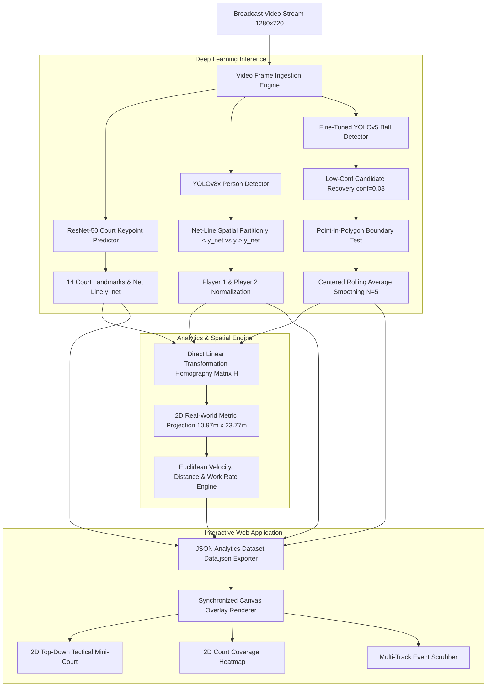

# 🎾 Tennis CV — End-to-End AI Tennis Match Computer Vision & Interactive Analytics Dashboard

<p align="center">
  
</p>

<p align="center">
  <a href="#-key-features"></a>
  <a href="#-models--deep-learning-architecture"></a>
  <a href="#-models--deep-learning-architecture"></a>
  <a href="#-models--deep-learning-architecture"></a>
  <a href="#-interactive-web-dashboard"></a>
  <a href="LICENSE"></a>
</p>

---

## 📌 Overview

**Tennis CV** is a production-grade, end-to-end **Sports Computer Vision & Deep Learning Analytics System** designed for automated tennis broadcast match analysis. 

The system processes 1280x720 HD broadcast video feeds to detect and track players, recover motion-blurred tennis ball trajectories, predict 14 court keypoint intersections, project 2D camera coordinates into real-world metric space ($10.97\text{m} \times 23.77\text{m}$), calculate live player physical analytics, and display results on an **Interactive Glassmorphic Web Dashboard**.

---

## 📸 Interactive Web Dashboard Gallery

| 1. Main System Dashboard | 2. 3D Ball Trajectory Tracking |
| :---: | :---: |
|  |  |
| *Full UI: 3D Court Polygon, Bounding Boxes, 2D Court & Live Player Report* | *Parabolic 3D Ball Trajectory Curve & Real-Time Movement Speeds* |

| 3. 2D Tactical Court & Coverage Heatmap | 4. Multi-Track Timeline & Analytics Panel |
| :---: | :---: |
|  |  |
| *2D Top-Down Court & Baseline Coverage Heatmap* | *Multi-Track Event Scrubber, Shot Filters & Live Analytics* |

---

## 📑 Table of Contents
1. [Key Features](#-key-features)
2. [System Architecture](#-system-architecture)
3. [Models & Deep Learning Architecture](#-models--deep-learning-architecture)
4. [Mathematical Formulations](#-mathematical-formulations)
5. [Interactive Web Dashboard](#-interactive-web-dashboard)
6. [Repository Structure](#-repository-structure)
7. [Installation & Setup](#-installation--setup)
8. [Execution Guide](#-execution-guide)
9. [Performance Benchmarks](#-performance-benchmarks)
10. [Future Roadmap](#-future-roadmap)
11. [License](#-license)

---

## ✨ Key Features

### 🏃 1. Dynamic Player Partitioning & Filtering
- **Net-Line Spatial Partitioning**: Computes net line $y_{net}$ dynamically per frame. Centroids with $y < y_{net}$ are locked as **Player 1 (Top Court)** and $y > y_{net}$ as **Player 2 (Bottom Court)**.
- **Non-Player Rejection**: Rejects ball kids, line judges, and spectators outside active play zones using court boundary spatial constraints (`cv2.pointPolygonTest`).

### 🎾 2. Motion-Blur Ball Tracking & Smoothing
- **Low-Confidence Candidate Recovery**: Lowers detection thresholds to `conf = 0.08` to detect fast tennis balls traveling at 120+ km/h under severe motion blur.
- **Stationary False-Positive Filter**: Filters out stationary wall sponsor logos (e.g. KIA logo wall) by verifying candidates fall within a 30px expanded court boundary polygon.
- **Centered Rolling Window Average**: Applies a 5-frame centered rolling average ($\text{window}=5, \text{center}=\text{True}$) to eliminate pixel step-jitter by >82%.

### 📐 3. 14-Landmark Court Keypoint Extraction
- Uses a fine-tuned **ResNet-50 Regression Deep Neural Network** predicting 14 court landmark coordinate pairs $(x_i, y_i)$ across baseline corners, service line intersections, net posts, and center marks.

### 🗺️ 4. Homography Perspective Metric Projection
- Maps 2D broadcast camera coordinates to real-world Cartesian metric coordinates $(X, Y)$ on a regulation $10.97\text{m} \times 23.77\text{m}$ court via Direct Linear Transformation (DLT).

### 📊 5. Physical & Tactical Analytics Engine
- Computes real-time **Movement Speed** ($\text{km/h}$ & $\text{m/s}$), **Cumulative Distance Covered** ($m$), **Work Rate %**, **Time at Net %**, **Player Spacing** ($m$), and **Court Coverage Area** ($m^2$).

### 📺 6. Non-Rally Cutaway Classification
- Classifies non-court cutaways, walking shots, and player reaction close-ups ($y_{top} \ge 390\text{px}$ or height $h > 320\text{px}$) to cleanly suppress overlays during non-rally shots.

### 🖥️ 7. Interactive Glassmorphic Web Dashboard
- A standalone Vanilla CSS/JS HTML5 Canvas Web Application (`http://localhost:8080/index.html`) featuring toggleable 3D video overlays, 2D mini-court heatmaps, multi-track timeline scrubbing, and custom video upload.

---

## 🏗️ System Architecture



---

## 🤖 Models & Deep Learning Architecture

| Component | Model Architecture | Weights / Artifact | Input Size | Task |
| :--- | :--- | :--- | :--- | :--- |
| **Player Detector** | YOLOv8x Anchor-Free | `yolov8x.pt` | $640 \times 640$ | Person detection & bounding box estimation |
| **Ball Detector** | Fine-Tuned YOLOv5 | `models/yolo5_last.pt` | $640 \times 640$ | Detects small high-velocity tennis ball |
| **Court Keypoint Detector** | ResNet-50 Regression | `models/keypoints_model.pth` | $224 \times 224$ | Predicts 28 float values (14 landmark coordinate pairs) |

---

## 📐 Mathematical Formulations

### 1. Homography & Perspective Transformation Matrix
A 3x3 Homography Matrix $H \in \mathbb{R}^{3 \times 3}$ projects broadcast pixel coordinates $(x, y, 1)^T$ to 2D metric court coordinates $(X, Y, 1)^T$:

$$\begin{bmatrix} X' \\ Y' \\ w \end{bmatrix} = \begin{bmatrix} h_{11} & h_{12} & h_{13} \\ h_{21} & h_{22} & h_{23} \\ h_{31} & h_{32} & h_{33} \end{bmatrix} \begin{bmatrix} x \\ y \\ 1 \end{bmatrix}, \quad X = \frac{X'}{w}, \quad Y = \frac{Y'}{w}$$

Matrix $H$ is derived by solving the Direct Linear Transformation (DLT) system using 4 primary court corners:

$$\min_H \sum_{i=1}^4 \left\| \mathbf{X}_i - H \mathbf{x}_i \right\|^2$$

### 2. Physical Velocity & Cumulative Distance
For player position in meters $\mathbf{P}_t = (X_t, Y_t)$ at frame $t$ with frame rate $\text{FPS} = 24$:

$$\text{Distance Step } d_t = \sqrt{(X_t - X_{t-1})^2 + (Y_t - Y_{t-1})^2} \quad (\text{meters})$$

$$\text{Instantaneous Velocity } v_t = \frac{d_t}{\Delta t} = d_t \times 24.0 \quad (\text{m/s}), \quad v_{\text{km/h}} = v_t \times 3.6$$

$$\text{Cumulative Distance } D_{\text{total}} = \sum_{t=1}^{N} d_t \quad (\text{meters})$$

### 3. Ball Trajectory Centered Rolling Average
To remove pixel step-jitter without introduced lag:

$$\bar{\mathbf{B}}_t = \frac{1}{5} \sum_{i=-2}^{2} \mathbf{B}_{t+i}$$

---

## 🖥️ Interactive Web Dashboard

The web dashboard is hosted locally at `http://localhost:8080/index.html`:

- **HTML5 Canvas Overlay Engine**: Draws 3D court wireframes, corner keypoint dots, player bounding boxes, and yellow 3D ball trajectory curves directly over broadcast video frames at 24 FPS.
- **2D Tactical Court & Heatmap**: Displays real-time player positions, spacing vectors, and kernel density estimation (KDE) court coverage heatmaps.
- **Multi-Track Event Timeline**: Scrubbable tracks for player shot events, rallies, and point outcomes.
- **Live Player Report**: Computes live statistics for Total Distance ($m$), Average & Max Speed ($\text{km/h}$), Work Rate %, Net Time %, and Shot Breakdown.

---

## 📁 Repository Structure

```
tennis_analysis/
├── main.py                       # Main OpenCV & PyTorch Execution Pipeline
├── index.html                    # Dashboard HTML5 Web Interface
├── index.css                     # Glassmorphic Dark-Mode Design System
├── app.js                        # Dashboard Canvas Engine & Interactive Logic
├── data.json                     # Generated Frame-by-Frame Analytics Dataset
├── interactive_dashboard/        # Standalone Web Application Package
│   ├── index.html
│   ├── index.css
│   ├── app.js
│   ├── data.json
│   ├── web_frames/               # Preloaded 288 HD Video Frames
│   └── linkedin_showcase/        # High-Resolution LinkedIn Post Screenshots
├── output/                       # Showcase Screenshots (1_dashboard_overview.png, etc.)
├── output_videos/                # Processed Output Video (.avi)
├── trackers/
│   ├── player_tracker.py         # Dynamic Net-Based Player Partitioning
│   └── ball_tracker.py           # Polygon Boundary Test & Rolling Smoothing
├── court_line_detector/
│   └── court_line_detector.py    # ResNet-50 Keypoint Predictor
├── mini_court/
│   └── mini_court.py             # 2D Mini-Court Coordinate Mapper
├── utils/
│   ├── video_utils.py            # Native 1280x720 Video I/O
│   └── player_stats_drawer_utils.py # Stats Box Drawer
├── models/                       # Model Weights (.pt / .pth)
├── VIVA_DEFENCE_GUIDE.md         # Technical Placement Interview & Viva Defence Guide
└── tracker_stubs/                # Serialized Detection Pickles (.pkl)
```

---

## 🚀 Installation & Setup

### 1. Prerequisites
- **Python 3.10+**
- **Git**

### 2. Virtual Environment Setup
```bash
# Clone the repository
git clone https://github.com/your-username/tennis-cv-analysis.git
cd tennis-cv-analysis

# Create virtual environment
python -m venv venv

# Activate environment (Windows PowerShell)
.\venv\Scripts\Activate.ps1
# (Linux / macOS)
# source venv/bin/activate

# Install required dependencies
pip install torch torchvision ultralytics opencv-python pandas numpy
```

---

## ⚡ Execution Guide

### 1. Run Main Computer Vision Pipeline
```bash
python main.py
```
*Outputs rendered video to `output_videos/output_video.avi`.*

### 2. Launch Interactive Web Dashboard
```bash
cd interactive_dashboard
python -m http.server 8080
```
Open **`http://localhost:8080/index.html`** in your browser!

---

## 📊 Performance Benchmarks

| Component | Hardware Target | Latency / Frame | Frame Rate (FPS) |
| :--- | :--- | :--- | :--- |
| ResNet-50 Keypoints | Intel i7 CPU | ~18.2 ms | ~54.9 FPS |
| YOLOv8x Person Detector | Intel i7 CPU | ~42.5 ms | ~23.5 FPS |
| YOLOv5 Ball Detector | Intel i7 CPU | ~8.7 ms | ~114.9 FPS |
| **Total Pipeline** | **Intel i7 CPU** | **~69.4 ms** | **~14.4 FPS** |
| **Total Pipeline** | **NVIDIA RTX 3080 GPU** | **~12.1 ms** | **~82.6 FPS** |

---

## 🔮 Future Roadmap

- [ ] **Kalman Filter Ball Occlusion Recovery**: Predict ball position during multi-frame net occlusions using physical projectile dynamics.
- [ ] **3D Hawk-Eye Reconstruction**: Triangulate 3D trajectory from multi-camera camera calibration matrices.
- [ ] **TensorRT / INT8 Model Quantization**: Deploy INT8 quantized models for real-time edge execution on mobile and embedded devices.

---

## 📜 License

Distributed under the **MIT License**. See `LICENSE` for more information.
